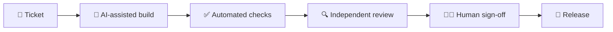

## 🦁 BEASTINCT · App and web development with AI, from Prague

**AI assists. A human reviews every change.**

We build custom websites, apps, platforms, online stores and AI systems for companies and startups.
Senior engineers lead the architecture and sign off every release. You know the price before each phase, and scope changes are agreed beforehand.

### 🧭 Start here

| If you… | Start with | What you get |
| --- | --- | --- |
| want a quick look at your website | 🦅 [Free website check](https://beastinct.com/en/free-audit) | Three numbers and three recommendations within 2 business days: mobile speed, AI visibility and accessibility. |
| want to know what is costing you sales | 🦅 [Eagle Audit](https://beastinct.com/en/eagle-audit) | A prioritized plan for speed, SEO, AI visibility, UX and accessibility in 5 business days, explained in a one-hour call. |
| are planning a product, platform or business AI | 🦁 [Lion Discovery](https://beastinct.com/en/lion-discovery) | Architecture, a clickable prototype and a risk map in 2–3 weeks. You know the price of phase one before you sign. |
| built an app with Lovable, Bolt, v0 or Cursor | 🛟 [Vibe Rescue](https://beastinct.com/en/vibe-rescue) | An audit of login, data, security and tests within 3 business days, then hardening before launch. |

### 🧰 What we build

- 📱 [Apps and platforms](https://beastinct.com/en/app-development): from a clickable prototype to production.
- 🌐 [Websites](https://beastinct.com/en/web-development) and [Shopify stores](https://beastinct.com/en/shopify-stores): fast, accessible and measurable.
- 🤖 [AI systems and agents](https://beastinct.com/en/ai-agents): assistants over your company data, support and sales, apps in ChatGPT or Claude. Agreed permissions, tests and a human handoff.
- 🎓 [AI training](https://beastinct.com/en/ai-training): AI literacy for the whole team, Claude Code and Codex for developers, AI for leaders.

### 🧠 How we build

Five BEAST gates and a validation report show what we check before anything ships. Read the standard: [How we build with AI](https://beastinct.com/en/how-we-build).

See the work: [case studies and recordings](https://beastinct.com/en/work) · Security and contracts: [what we do with your data, code and AI](https://beastinct.com/en/security)

### 🃏 Our product

[Plandeck](https://plandeck.app): AI planning poker for distributed teams. Free to start.

---

**→ [Tell us about your project](https://beastinct.com/en/contact)** and you'll hear from Filip or Josef.

🐺 [Meet the Pack](https://beastinct.com/en/team) · [Careers](https://beastinct.com/en/careers) · 🔐 security@beastinct.com · 📍 Prague
