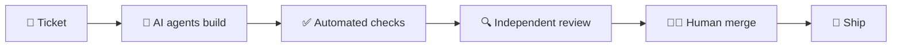

## 🦁 BEASTINCT · App and web development with AI, from Prague

**AI writes the code. We make sure it survives in the wild.**

We build apps, platforms, websites, online stores and AI agents for companies and startups.
Senior people make the architecture and quality calls, and a human signs off every change.
We build in phases, each at a fixed price.

| | What we do |
| --- | --- |
| 📱 **Apps and platforms** | From a clickable prototype to production. |
| 🤖 **AI agents and AI training** | Connected to your data, tested for quality, taught to your team. |
| 🛒 **Websites and online stores** | Fast, accessible and measurable. |

### 🧠 How we build

One ticket, one pull request. Every change passes automated checks, tests and an independent review before a human merges it.

### 🚀 Start here

- 🦅 **Have a website or online store?** Get a free audit.
- 🦁 **Building something new?** A clickable prototype and a fixed price for the first phase.

→ [beastinct.com](https://beastinct.com)

### 🃏 Our product

[Plandeck](https://plandeck.app): scrum poker for agile teams, with AI-assisted estimation.

---

🔐 Security: security@beastinct.com · 🐺 Join the Pack: jobs@beastinct.com · 📍 Prague
